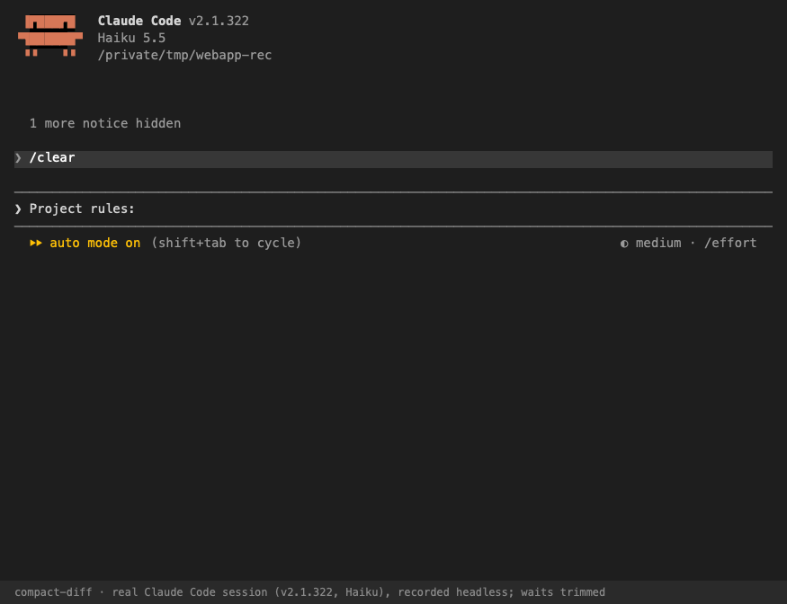

# compact-diff

**See what `/compact` dropped, and put the critical pieces back.**


<sub>A real Claude Code session (v2.1.322, Haiku), recorded headless with waits trimmed. In this run the summary kept 8 of 9 tracked items, with one decision only partly kept. For a session where things do get dropped, see the [replay on a synthetic session](launch/demo/demo.gif). Details in [launch/demo](launch/demo/).</sub>

compact-diff is a Claude Code plugin that audits every compaction, manual or automatic. Before compaction it records the session's working state: the rules you gave, open tasks, unresolved errors, files edited and decisions made. After compaction it checks which of those the summary lost. You get a one-line verdict and a full report, and only the **missing** items are re-injected into Claude's context.

```
compact-diff: summary kept 4/12 tracked items; 7 dropped, 1 partial (3 user instructions, 2 files edited, 1 open tasks, 1 unresolved errors, 1 decisions).
```

It is stdlib Python with no dependencies, no network calls and no model calls. Everything stays on your machine.

## Why

Compaction replaces hours of context with a summary of a few thousand tokens. The summary is usually good. When it isn't, nothing tells you. Claude just stops following the rule you set an hour ago. Users have asked for visibility into this:

- [anthropics/claude-code#89831](https://github.com/anthropics/claude-code/issues/89831): *Pre-compaction notice + visible record of what compaction dropped*
- [anthropics/claude-code#29890](https://github.com/anthropics/claude-code/issues/29890): *Context compaction loses critical working knowledge mid-session*
- [anthropics/claude-code#60973](https://github.com/anthropics/claude-code/issues/60973): *Auto-signal context compaction + recommend state refresh after /compact*

Existing tools take a different approach. Memory plugins (claude-mem and similar) build long-term memory across sessions. Snapshot-and-restore plugins (ctx, context-recovery, amnesia) save state before compaction and replay all of it afterwards. That duplicates whatever the summary already kept, and it never tells you what was actually lost. compact-diff is the **diff**: it measures the loss, shows it to you, and restores only the gap.

## What a report looks like

From the synthetic session in [`examples/auth-refactor.jsonl`](examples/auth-refactor.jsonl):

```
$ python3 scripts/cdiff.py audit examples/auth-refactor.jsonl

Kept 4 · Partial 1 · Dropped 7 of 12 tracked items.

| Kind              | Kept | Partial | Dropped |
| User instructions |    1 |       0 |       3 |
| Open tasks        |    1 |       0 |       1 |
| Unresolved errors |    0 |       0 |       1 |
| Files edited      |    2 |       0 |       2 |
| Decisions         |    0 |       1 |       0 |

## Dropped
User instructions
- Never push to main directly; open a PR instead.
- Don't touch anything in the legacy/ folder, it is frozen for the audit.
- Also, keep the old /api/v1/login endpoint working until the mobile app ships 4.2; it must return a deprecation header.
Open tasks
- Add refresh-token rotation to the API gateway — pending
Unresolved errors
- TypeError: Cannot read properties of undefined (reading 'refreshToken') — Bash: pnpm test tests/auth.test.ts
Files edited
- src/middleware/session.ts, tests/auth.test.ts
```

The summary kept "use pnpm, not npm" and the PKCE decision. It dropped the rule about never pushing to main. That rule is the one you want back.

## How it works

```
 PreCompact ──► extract working state from the transcript ──► pending.json
     │          print a steering note → Claude Code appends it to the summariser's instructions
     ▼
 [compaction]
     ▼
 PostCompact ─► diff state vs compact_summary ──► report-*.json / report-*.md
     ▼
 SessionStart(compact) / next UserPromptSubmit / next PostToolUse
            ──► additionalContext: only the dropped and partial critical items
            ──► systemMessage: one-line verdict + report path
```

| Hook | What compact-diff does |
| :- | :- |
| `PreCompact` (`manual`, `auto`) | Reads `transcript_path` and extracts the items below. Its stdout is added to the summariser's instructions, so it first asks the summariser to keep those items. Set `COMPACT_DIFF_STEER=0` to measure the unsteered summary instead. |
| `PostCompact` | Receives `compact_summary`, scores each item as *kept*, *partial* or *dropped*, and writes the report. PostCompact can't add context. |
| `SessionStart` (`compact`) | Delivers the verdict and the re-injection if the report is ready. |
| `UserPromptSubmit`, `PostToolUse` | Fallback delivery (see below). A shell guard returns before starting Python unless a report is waiting, so these hooks cost one `ls` per call. |

**Delivery fallback.** In Claude Code 2.1.252, `SessionStart:compact` fires *before* `PostCompact` and before the summary reaches the transcript, so the report isn't ready yet at SessionStart. compact-diff then delivers on the next `UserPromptSubmit`, or on the next `PostToolUse` when auto-compaction happens mid-turn. Each report is delivered once. If PostCompact never runs (older Claude Code), the summary is read from the transcript instead.

### What it tracks

| Kind | Source | Re-injected when |
| :- | :- | :- |
| User instructions | Sentences you typed that read as rules ("never…", "don't…", "always…", "X, not Y", "make sure…"). Taken from the **whole** transcript, because rules outlive compactions. | dropped or partial |
| Open tasks | `TaskCreate`/`TaskUpdate` and `TodoWrite` items not completed | dropped or partial |
| Unresolved errors | Tool errors and error lines in Bash output in the last 40 tool calls, unless the same command later succeeded | dropped |
| Files edited | `Edit`/`Write`/`MultiEdit`/`NotebookEdit` targets in the compacted window | dropped |
| Decisions | Claude's own sentences like "going with X instead of Y" | dropped |

### How "kept" is decided

Matching is lexical and deterministic. Files and errors count as kept when the summary names them (basename, exception class). Other items are scored by the share of their significant words found in the best three-sentence window of the summary: **kept ≥ 70%**, **partial ≥ 40%**, otherwise **dropped**. A negation guard stops "never deploy on Friday" from counting as kept when the summary only says "deploy on Friday".

This is a heuristic. It will sometimes call a paraphrase *partial*, and it can miss a rule phrased in an unusual way. The re-injection is built to fail safe: a false *dropped* costs a few hundred tokens of duplicate context, while a missed rule costs much more.

### How accurate is it?

Measured on 12 real compactions and 329 labelled items ([full evaluation](launch/EVALUATION.md); labels by blind LLM annotators, not people yet):

- It catches **94% of the items a summary lost**.
- When it says **kept**, it is right **97.5%** of the time.
- It is **too pessimistic about reworded rules**: 55% precision on "lost instruction". Files are near-perfect (98% accuracy).
- Partial vs. dropped is unreliable, so read them as one "check this" bucket.
- Threshold tuning didn't improve held-out accuracy, so the defaults stand.

In the same data, compaction left **27%** of tracked working state not fully kept, including **42% of user rules** and **71% of unresolved errors**.

## Install

This repository is also its own plugin marketplace (`.claude-plugin/marketplace.json`), so you can install straight from GitHub. Inside Claude Code:

```
/plugin marketplace add bishtashish708/compact-diff
/plugin install compact-diff@compact-diff
```

Then restart Claude Code. To pick up new releases later:

```bash
claude plugin marketplace update compact-diff && claude plugin update compact-diff@compact-diff
```

To remove it, run `claude plugin uninstall compact-diff@compact-diff`.

Or try it for one session without installing anything:

```bash
git clone https://github.com/bishtashish708/compact-diff
```

```bash
claude --plugin-dir ./compact-diff
```

Requires `python3` (3.9+) on `PATH` and a Claude Code version with the `PostCompact` hook. Tested on macOS with Claude Code 2.1.252 and 2.1.322. Linux should work. Windows is untested, and the guard hooks need a POSIX shell.

## Use

- **Automatic.** After each compaction you see one line, `compact-diff: summary kept N/M tracked items…`, with the report path. Claude receives the dropped items as context.
- **`/compact-diff:report`** shows the latest report for the current project, including what was re-injected.
- **Audit past sessions.** These commands are read-only and work without the plugin installed:

```bash
python3 scripts/cdiff.py audit ~/.claude/projects/<project>/<session>.jsonl
```

```bash
python3 scripts/cdiff.py scan ~/.claude/projects
```

`scan` adds up every compaction in your history. These are the tool's own estimates; it overstates instruction loss (see accuracy above):

```
Kind                  Tracked    Kept  Partial  Dropped   Lost %
User instructions         148      39       43       66      59%
Open tasks                  2       2        0        0       0%
Unresolved errors          17       2        8        7      65%
Files edited              180     160        0       20      11%
Decisions                  20       2        7       11      72%
```

**Forked sessions:** with `--fork-session`, Claude Code hasn't written the fork's transcript when PreCompact fires. compact-diff recovers the snapshot afterwards, so the report and re-injection still work, but it can't steer that summary.

## Configuration

| Variable | Default | Effect |
| :- | :- | :- |
| `COMPACT_DIFF_STEER` | `1` | `0` turns off the PreCompact steering note, so you measure the summariser unaided |
| `COMPACT_DIFF_INJECT` | `1` | `0` reports only and never adds context |
| `COMPACT_DIFF_HOME` | `$CLAUDE_PLUGIN_DATA` | Where state and reports are written |

## Privacy

compact-diff reads the session transcript that Claude Code passes to hooks. It writes small JSON and Markdown files to the plugin's data directory, which Claude Code deletes when you uninstall the plugin. It makes no network requests and no model calls. See [PRIVACY.md](PRIVACY.md).

**What it runs.**
- `PreCompact`, `PostCompact` and `SessionStart` run `python3 scripts/cdiff.py` (stdlib only).
- `UserPromptSubmit` and `PostToolUse` run `sh scripts/deliver-guard.sh`, which lists the plugin's `flags/` folder and starts Python only when a report is waiting.
- `/compact-diff:report` runs `python3 scripts/cdiff.py report`.
- Nothing is downloaded or installed.

## Development

```bash
python3 -m unittest discover -s tests -v
```

```bash
claude plugin validate . --strict
```

`tests/fixtures/build.py` regenerates `examples/auth-refactor.jsonl`. Synthetic fixtures only: please don't commit real transcripts.

## Demo plan

1. **30-second GIF.** Done: [`launch/demo/`](launch/demo/), a replay of the real hook code on the synthetic session. A real Claude Code session is in [`launch/demo/real-demo.gif`](launch/demo/real-demo.gif).
2. **"How much does compaction drop?" post.** Published as [`launch/how-much-does-compaction-drop.md`](launch/how-much-does-compaction-drop.md). Still to do: aggregates from a few volunteers' `scan` runs.
3. Reply on #89831 and #29890 with the report screenshot and the install line.

## Roadmap

- [x] **Evidence pass v0.1.** 12 compactions, 329 items, precision/recall per kind, threshold sweep ([EVALUATION.md](launch/EVALUATION.md)).
- [ ] Human labelling pass with inter-annotator agreement, and more compactions from more people.
- [x] Steering experiment v0.1: rules not fully kept fell from 47% to 18%, but one session lost its file list ([EVALUATION.md §4](launch/EVALUATION.md)).
- [ ] Slimmer steering note: leave long file lists to re-injection.
- [x] Better instruction extraction: filter spec prose, quoted text and narrative (82% → 89% precision, in-sample).
- [ ] Optional semantic matcher, with a `type: "prompt"` hook or a local embedding, behind a flag.
- [ ] Track more state: git branch and uncommitted files, running background tasks, env and config changes, URLs and IDs the user gave.
- [ ] Re-injection budget from `userConfig`, plus per-kind on/off switches.
- [ ] `/compact-diff:pin <text>` to mark something that must always survive.
- [ ] HTML report with a side-by-side view of the pre-compaction excerpt and the summary.
- [ ] Windows support (PowerShell guard), and a CI job that loads the plugin in a real `claude` session.
- [ ] Submit to Anthropic's plugin directory.

## License

MIT
